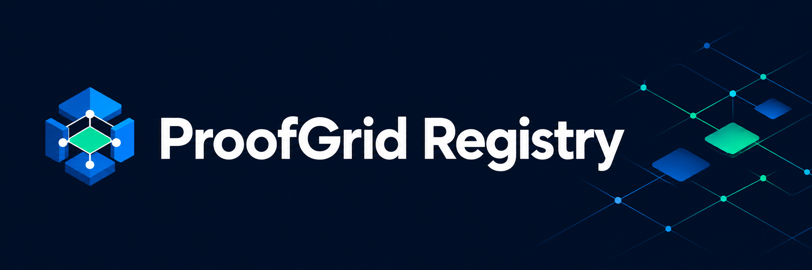

# ProofGrid Registry



[](https://github.com/proofgrid-energy/proofgrid-registry/actions/workflows/ci.yml)

**Source-backed manufacturer evidence requirements, expressed as scoped, testable Rule Packs.**

Different solar equipment manufacturers ask for different information when a fault or claim is reported. ProofGrid Registry maps selected requirements into a common evidence model, records where each rule came from, and tests the expected behavior with synthetic records.

**Status: functional developer preview.** Four manufacturer packs run against the same core schemas and runtime. Coverage is deliberately partial: the current complete examples return `review_required`, because applicability and some source clauses remain unresolved. A successful field check does not establish warranty eligibility or approval.

## Where this repository fits

[ProofGrid Core](https://github.com/proofgrid-energy/proofgrid-core) owns the schemas, validator and CLI. This repository owns manufacturer sources, product/context scopes, Rule Packs, catalog and fixtures. [ProofGrid Stellar](https://github.com/proofgrid-energy/proofgrid-stellar) adds optional testnet commitments and current-status verification.

Registry includes a pinned core package, so the examples run from this checkout alone. No sibling repository, wallet or blockchain connection is needed.

## Quick start

Requires **Node.js 24+**, npm and Git.

```sh
git clone https://github.com/proofgrid-energy/proofgrid-registry.git
cd proofgrid-registry
npm ci
npm test
npm run demo
```

Expected: **39 tests pass** for the September 5, 2026 preview, followed by one JSON assessment summary for each manufacturer. The demo asserts that each complete example returns `review_required`; the demo command itself succeeds.

**Windows PowerShell:** use `npm.cmd` in place of `npm`. If Node is installed in `C:\Program Files\nodejs` but the terminal cannot find it:

```powershell
$env:Path = "C:\Program Files\nodejs;$env:Path"
node --version
npm.cmd --version
```

This adjusts only the current terminal. Run commands one at a time and copy them without terminal prompts.

## Read an assessment

Run the following as **one complete line**, including `--date` and `--format`:

```sh
node node_modules/@proofgrid/core/dist/src/cli.js assess --record examples/dyness-claim.json --catalog catalog.json --jurisdiction africa --date 2026-09-05 --format text
```

The report begins with:

```text
ProofGrid: review_required
Selection: selected
Pack: dyness-claim-intake @ 0.2.0
Applicability: unknown
```

It then lists five satisfied checks, three unresolved rules, source locators and coverage limits. Supplying a date does not establish the source's unknown effective dates. Use `--format json` for the structured report.

| Exit code | Outcome | Interpretation |
| --- | --- | --- |
| `0` | `scoped_checks_met` | Named scoped checks are met |
| `1` | `incomplete` | Evidence requirements or reference checks are not met |
| `2` | `review_required` | Uncertainty or unresolved questions need review |
| `3` | `invalid` | Input or command cannot be assessed |

This example intentionally exits `2`. In PowerShell, run `$LASTEXITCODE` immediately afterward to inspect it. No outcome means manufacturer approval.

## Current catalog

| Manufacturer | Model | Executable scope | Example |
| --- | --- | --- | --- |
| Growatt | MIN 5000TL-X | Equipment identity, PV/grid configuration and fault description | [Record](examples/growatt-claim.json) |
| Dyness | DL5.0C Pro | Serial, paired inverter/specification references, operating/PV/load data, fault and logs | [Record](examples/dyness-claim.json) |
| Deye | SUN-5K-SG04LP1-AU | Equipment identity, PV/grid data, installation date and fault/date | [Record](examples/deye-claim.json) |
| Victron | BAT512110610 | Presence of battery-usage proof | [Record](examples/victron-claim.json) |

Each entry in [catalog.json](catalog.json) points to a versioned pack. The [source register](sources/index.json) records source URLs and capture/review metadata. See the [intake source review](docs/research/claim-intake-review.md) and [fourth-manufacturer experiment](docs/research/fourth-manufacturer.md). Victron was added without changing core or its schemas. The earlier partial Dyness M1 pack remains for regression testing and is excluded from catalog selection.

Model and jurisdiction limits matter: Deye's AU/NZ scope does not imply Nigeria coverage, and Victron's `unspecified` jurisdiction label does not mean worldwide applicability. Core does not infer geographic equivalence.

## How rules are maintained

An executable rule needs an identified source and locator, an explicit product/context scope, and fixtures demonstrating its behavior. Source review dates, policy effective dates and pack versions remain distinct. Conflicting or unreadable clauses stay unresolved instead of becoming guessed requirements.

Presence of an invoice, log or proof reference does not verify its contents. Current unresolved work includes Dyness proof/deadline wording, Deye invoice/log/serial-era conditions and the correctness of Victron usage proof. Whole-policy coverage and manufacturer authorization are not claimed.

Manufacturer documents remain linked and retain their own rights. Capture hashes are recorded only for bytes actually obtained; a missing hash is not invented. No manufacturer endorsement or certification is implied by inclusion in the catalog.

## Reproducible local checks

```sh
npm test
npm run check:contract -- --package node_modules/@proofgrid/core
```

Tests check catalog selection, positive/negative fixtures, uncertainty, reference behavior, citations and pinned artifact integrity. [CI](https://github.com/proofgrid-energy/proofgrid-registry/actions/workflows/ci.yml) runs the tests and installed-package contract check in a standalone checkout.

The private `@proofgrid/core@0.2.0-draft.0` tarball is stored in [vendor/](vendor/) and pinned through the lockfile, with [source/hash provenance](contracts/core-0.1/provenance.json). Packages are not published to npm. `npm ci` still downloads transitive dependencies. The older M1 archive is a historical capture; only the current pinned artifact is installed.

The optional `node scripts/check-contract.mjs --core ../proofgrid-core` command compares canonical schema source bytes with a sibling checkout. Do not hand-edit snapshots or replace the pinned artifact merely because another checkout has newer documentation. Archive hashes identify captured bytes, not a reproducible-build or policy-completeness guarantee.

## Contribute

Read [CONTRIBUTING.md](CONTRIBUTING.md) and the [backlog](docs/backlog.md). Useful work includes authoritative source clarification, independent pack review and narrowly scoped country-specific research. Preserve the prior interpretation when revising a rule, explain the source change, and add targeted regression fixtures.

Use synthetic evidence only. Follow [SECURITY.md](SECURITY.md) for sensitive reports, and keep customer documents out of public examples and issues.

## License

New ProofGrid source uses [MPL-2.0](LICENSE). [LICENSING.md](LICENSING.md) preserves earlier Apache grants and third-party notices. Manufacturer source documents retain their own rights; the software license does not relicense them.
